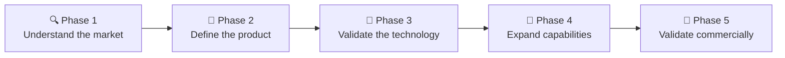

# 🚀 XPact – Strategic Action Plan

> **What XPact should become after internship part 1, and how to get there.**
> Six strategic areas, a five-phase roadmap and six concrete deliverables.
> Related: [Comprehensive Overview Summary](Comprehensive-Overview-Summary-of-the-Project.md) (where XPact stands today) · [Project knowledge map](PROJECT-KNOWLEDGE.md) · [Decision log](decision-log.md)

> [!TIP]
> **The guiding question:** don't start by asking *what features XPact can have*.
> Start by asking **what expensive or difficult problem XPact can solve better than existing alternatives.**
> That answer should guide the AI integration, scalability investments, ecosystem and commercial strategy.

---

## 🧭 At a glance

| # | Area | Objective in one line | Deliverable | Phase |
|:-:|---|---|---|:-:|
| 1 | 📈 [Scalability](#1--scalability--prepare-xpact-for-growth) | Handle growing workloads without losing reliability or speed | Scalability and performance report | 3 |
| 2 | 🤖 [AI Integration](#2--ai-integration--add-practical-ai-capabilities) | Add AI where it creates real value for customers | AI proposal + proof of concept | 4 |
| 3 | 🏭 [Industrial Use Cases](#3--industrial-use-cases--identify-real-world-applications) | Find where XPact solves real industry problems | Three documented use cases | 1 |
| 4 | ⚔️ [Competitive Analysis](#4-️-competitive-analysis--find-xpacts-market-opportunity) | Find XPact's place next to Expat, Xerces and others | Competitive analysis + differentiation strategy | 1 |
| 5 | 🎯 [Vision & Positioning](#5--vision-philosophy--market-positioning) | Decide what XPact wants to become | Vision and positioning document | 2 |
| 6 | 🌐 [Ecosystem](#6--ecosystem-development--build-around-xpact) | Make XPact easy to adopt, integrate and extend | Ecosystem architecture + roadmap | 4 |

**Progress:** ☐ 0 of 41 actions done · ☐ 0 of 6 deliverables done

---

## 1. 📈 Scalability – Prepare XPact for growth

> **🎯 Objective:** Ensure XPact can handle increasing workloads, users and XML documents without compromising reliability or performance.

**Actions**
- [ ] Define scalability requirements (documents per second, file sizes, concurrent users).
- [ ] Benchmark XPact under increasing workloads.
- [ ] Identify performance bottlenecks in parsing, memory usage and processing.
- [ ] Implement load and stress testing.
- [ ] Investigate parallel processing and worker distribution.
- [ ] Test how XPact behaves under high concurrency.
- [ ] Document performance limits and establish measurable targets.

> **📦 Deliverable:** Scalability and performance report with benchmarks and recommendations.

<b>🔎 Starting point from part 1</b>

| Already measured | Result | Where |
|---|---|---|
| Speed vs Expat 2.8.1 (same C API) | median ~17× slower, 0 checksum mismatches | [fair speed test](../student/results/fair-speed-2026-11-10/README.md) |
| Multi-core (Gobo build) | 4 threads 0.40 s vs 0.67 s on 1 | [gobo-dll §4](../reports/gobo-dll/README.md) |
| Known limits | scaling stops at 4 threads ([#431](https://github.com/andersoxie/xpact/issues/431)); one parse = one core ([#432](https://github.com/andersoxie/xpact/issues/432)); ISO-8859-1 in pieces quadratic ([#272](https://github.com/andersoxie/xpact/issues/272)) | open issues |
| Website load | worker cap and queue limits; no load test on a real server yet | [website security](../website/docs/security.md) |

---

## 2. 🤖 AI Integration – Add practical AI capabilities

> **🎯 Objective:** Identify where AI can create real value for XPact customers.

**Actions**
- [ ] Investigate AI-powered XML error explanations.
- [ ] Explore automatic XML error diagnosis and suggested fixes.
- [ ] Investigate AI-assisted XML structure analysis.
- [ ] Explore natural-language reporting for validation results.
- [ ] Evaluate integration with external AI APIs and locally hosted AI models.
- [ ] Define which AI capabilities should be built into XPact and which should remain optional.

> **📦 Deliverable:** AI integration proposal with 2–3 practical features and a proof of concept.

<b>💡 Natural first candidate</b>

The XPact website already shows parser errors (code, line, column) for uploaded documents. An "explain this error and suggest a fix" button there would be a small, visible proof of concept, kept optional so the parser itself stays deterministic.

---

## 3. 🏭 Industrial Use Cases – Identify real-world applications

> **🎯 Objective:** Establish where XPact solves actual problems in industry.

**Actions**
- [ ] Identify three industries that rely heavily on XML.
- [ ] Research how those industries currently process, validate and exchange XML.
- [ ] Identify existing problems, limitations and costs.
- [ ] Determine where XPact could improve their workflows.
- [ ] Define one realistic customer scenario for each industry.
- [ ] Evaluate technical requirements and potential commercial value.

**Potential industries to investigate**

| Industry | Potential XPact application |
|---|---|
| 🏦 **Finance** | Validation of XML-based financial data exchange. |
| 🏥 **Healthcare** | Validation of structured healthcare data and document exchange. |
| 🏗️ **Manufacturing** | Validation of XML-based configuration and system integration files. |

> **📦 Deliverable:** Three documented industrial use cases, including customer problems, proposed solutions and business value.

---

## 4. ⚔️ Competitive Analysis – Find XPact's market opportunity

> **🎯 Objective:** Understand how XPact can compete with, complement or potentially replace existing solutions.

**Actions**
- [ ] Identify the main XML parsers and competing products.
- [ ] Compare XPact against Expat, Xerces and other relevant alternatives.
- [ ] Compare functionality, compatibility, performance, licensing and integration.
- [ ] Identify weaknesses and advantages in existing solutions.
- [ ] Find market gaps that existing products do not adequately address.
- [ ] Identify scenarios where customers would have a reason to switch to XPact.
- [ ] Define XPact's unique selling proposition (USP).

> **📦 Deliverable:** Competitive analysis and product differentiation strategy.

<b>🧩 Comparison grid to fill in</b>

| Criterion | XPact | Expat | Xerces | libxml2 | Others |
|---|---|---|---|---|---|
| Functionality | | | | | |
| Compatibility (Expat API) | ✅ same C API | reference | | | |
| Conformance (W3C) | ✅ 2,585 / 0 failed | | | | |
| Performance | ~17× slower than Expat | | | | |
| Safety by contract (DbC) | ✅ Eiffel contracts | | | | |
| Licensing | ☐ to decide | | | | |
| Integration | Windows DLL | | | | |

---

## 5. 🎯 Vision, Philosophy & Market Positioning

> **🎯 Objective:** Establish what XPact wants to become and what position it should occupy in the market.

**Actions**
- [ ] Define XPact's long-term vision.
- [ ] Establish the core philosophy and principles behind the product.
- [ ] Define the primary target audience and customer segments.
- [ ] Determine which problems XPact wants to solve.
- [ ] Establish how XPact should be perceived compared with competitors.
- [ ] Define its primary value proposition.
- [ ] Establish short-term and long-term product goals.

> **📦 Deliverable:** XPact vision and market positioning document.

> [!NOTE]
> The project already has a tagline to build on: **"XML parsing, by contract."** It comes from the idea of using Design by Contract to catch the security flaws other parsers miss ([README](../README.md)).

---

## 6. 🌐 Ecosystem Development – Build around XPact

> **🎯 Objective:** Develop an ecosystem that makes XPact easier to adopt, integrate, extend and maintain.

**Actions**
- [ ] Define the core XPact product and its surrounding components.
- [ ] Investigate integrations with existing development tools and platforms.
- [ ] Develop API documentation and integration examples.
- [ ] Explore SDKs and language bindings.
- [ ] Establish automated testing and continuous integration.
- [ ] Investigate a plugin or extension architecture.
- [ ] Build developer documentation and onboarding resources.
- [ ] Explore community contributions and third-party integrations.

> **📦 Deliverable:** XPact ecosystem architecture and development roadmap.

<b>🔎 Starting point from part 1</b>

- C API compatible with Expat 2.8.1 ([include/xpact.h](../include/xpact.h)); a C# P/Invoke test program shows a first language binding.
- Website with validator, docs, conformance and benchmark pages; Docker image ready.
- GitHub Actions, CodeQL, Dependabot and SonarQube in place; Eiffel builds and W3C runs not yet in CI.

---

## 🗺️ Recommended execution order

> **Don't develop all six areas at the same time.** Some decisions depend on others: the market tells you what to build, the product definition tells you what to validate.

| Phase | Focus | Covers | Areas |
|:-:|---|---|---|
| **1** 🔍 | **Understand the market** | Competitive analysis, industrial use cases and target audience | 3 · 4 |
| **2** 🎯 | **Define the product** | Vision, philosophy, positioning and unique selling proposition | 5 |
| **3** 🧪 | **Validate the technology** | Scalability benchmarks, performance testing and architecture | 1 |
| **4** 🧩 | **Expand capabilities** | AI proof of concept, APIs, integrations and ecosystem | 2 · 6 |
| **5** 💼 | **Validate commercially** | Demonstrate real-world use cases, test with potential customers and evaluate willingness to adopt XPact | all |

---

## 🏁 Final deliverables

By completing this plan, XPact should have **six concrete outcomes**:

| # | Deliverable | Area | Done |
|:-:|---|---|:-:|
| 1 | 📈 Scalability and performance report | Scalability | ☐ |
| 2 | 🤖 AI integration proposal and working proof of concept | AI Integration | ☐ |
| 3 | 🏭 Three real-world industrial use cases | Industrial Use Cases | ☐ |
| 4 | ⚔️ Competitive analysis and differentiation strategy | Competitive Analysis | ☐ |
| 5 | 🎯 Vision, philosophy and market positioning document | Vision & Positioning | ☐ |
| 6 | 🌐 Ecosystem architecture and development roadmap | Ecosystem | ☐ |

---

## 💡 Strategic recommendation

> [!IMPORTANT]
> **Don't start by asking what features XPact can have.**
> **Start by asking what expensive or difficult problem XPact can solve better than existing alternatives.**
>
> That answer should guide the AI integration, scalability investments, ecosystem and commercial strategy.
