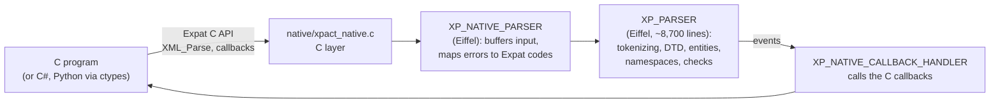
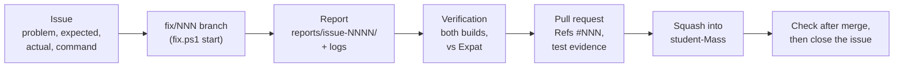

# Internship Report: Building Confidence in an XML Parser through Tests and Reproducible Results

## A technical investigation of the xpact parser: build, assertions, conformance and comparison with Expat

> **Student:** Masoud Dehdar ✏️ · **Programme:** System Developer ✏️ · **University:** Medieinstitutet
> **Company:** Bsharp · **Supervisor:** Anders Persson ✏️ · **Internship:** 6 October – 27 November 2026 (eight weeks; build preparation from September)
> **Repository:** [github.com/andersoxie/xpact](https://github.com/andersoxie/xpact), branch `student-Mass` · **Report state:** `student-Mass` @ `1280aee` (2026-11-01)
>
> ✅ done and verified · 🟡 partly done or waiting · 🔴 open problem · ⏭️ dropped by decision · ✏️ for the student to check or complete

---

## Abstract

xpact is an XML parser written in Eiffel that offers a C interface compatible with Expat, the most widely used C XML parser. The internship's question, set by the company, was: **how can we demonstrate that xpact handles valid and invalid XML consistently, with assertions enabled?**

In the first four weeks of the eight-week internship, the work moved from making the parser build reliably on Windows, through an assertions-enabled baseline and failure reporting, to large comparisons with Expat 2.8.1. Every problem found was handled the same way: reproduce it, record the exact command and evidence, find the cause, fix it in one focused pull request, and verify the result before closing the issue.

The main results: the full W3C XML Conformance Test Suite (**2,585 cases**) now runs with no skips and **0 failures** in both builds, against 1,360 crashes with assertions on at the start; xpact gives **the same verdict as Expat in every comparison made** (4,308 C-API cases, 1,302 chunked configurations); and **82 pull requests and 80 closed issues** document the work. The investigation also showed what is still missing: error positions and some events still differ from Expat, and the native library is 25–40 times slower than Expat because it re-parses its input on every call.

---

## 🚦 At a glance

| | Result |
|---|---|
| ✅ **Builds** | The Eiffel-backed native DLL builds and passes its smoke test in both tiers (assertions on and off); the build fixes are in `main` |
| ✅ **W3C conformance** | 2,585 / 2,585 cases run, **2,283 checked + 302 "no crash only", 0 failed, 0 errors, 0 skipped** (both builds) |
| ✅ **Same verdict as Expat 2.8.1** | 4,308 / 4,308 C-API cases (C# DLL tests) · 1,302 / 1,302 chunked configurations (G03) · 2,585 W3C cases through the DLL |
| ✅ **Failures are reported** | A failing test now exits nonzero in every build (B01), proven by a switchable meta-test (B02) |
| ✅ **Traceable work** | 89 issues (80 closed), 82 merged pull requests, one report with logs per fix in `reports/issue-NNNN/` |
| 🟡 **Still differs from Expat** | Error positions, and some events and error codes in edge cases: 6 open findings (#123, #126, #170, #171, #176, #13) |
| 🔴 **Speed** | The DLL is 25–40× slower than Expat on a whole document, and re-parses markup on every call when input arrives in pieces |

<details>
<summary><b>Contents</b></summary>

1. [Introduction](#1-introduction)
2. [Project background](#2-project-background)
3. [Objectives and scope](#3-objectives-and-scope)
4. [Development environment and technologies](#4-development-environment-and-technologies)
5. [Methodology and working approach](#5-methodology-and-working-approach)
6. [Work performed](#6-work-performed)
7. [Technical investigations](#7-technical-investigations)
8. [Testing and quality assurance](#8-testing-and-quality-assurance)
9. [Version control and development workflow](#9-version-control-and-development-workflow)
10. [Results and achievements](#10-results-and-achievements)
11. [Reflection and learning outcomes](#11-reflection-and-learning-outcomes)
12. [Discussion](#12-discussion)
13. [Conclusion and future work](#13-conclusion-and-future-work)
14. [References](#14-references)
15. [Appendices](#15-appendices)

</details>

---

## 1. Introduction

### 1.1 Background
The internship took place at **Bsharp**, from 6 October to 27 November 2026 (eight weeks), as part of the System Developer programme at **Medieinstitutet** ✏️, in a team developing **xpact**, an XML parser. The student's role was that of a junior software developer working on **testing and verification**: learning an unfamiliar codebase, building it, running and extending its tests, and reporting and fixing what the tests found. The work followed the company's ten-week student plan (`docs/xpact-student-introduction.md`). In the first four weeks of the internship (to 1 November), weeks 1–7 of that plan were completed. The remaining weeks, to 27 November, are for weeks 8–10: consolidation, this report, the demonstration and the handover.

### 1.2 Purpose of the report
The report documents and analyses the technical work: how the problems were found, what caused them, how they were solved and how each solution was verified. It also evaluates what the tests prove and what they do not, and reflects on what was learned.

### 1.3 Report structure
Sections 2–5 describe the project, the goals, the tools and the method. Section 6 gives the chronology, and section 7 analyses six selected problems in depth. Sections 8–10 present the testing, the workflow and the results; sections 11–13 reflect, discuss and conclude. The appendices hold the demonstration commands, the result tables tied to builds and the list of contributions.

---

## 2. Project background

### 2.1 xpact and Expat
An XML parser reads text such as `<book id="1"><title>Hello</title></book>`, checks that it follows the XML rules, and reports what it finds to another program as **events**: start `book`, start `title`, text `Hello`, end `title`, end `book`. If the document breaks the rules, for example `<book><title>Hello</book>`, the parser must report an error.

**Expat** is a widely used XML parser written in C, with a stable C interface (`XML_ParserCreate`, `XML_Parse`, callbacks for each event). xpact aims to offer **the same C interface**, so that programs written for Expat can use xpact, while the parser itself is written in **Eiffel**, a language with **Design by Contract**: routines state preconditions, postconditions and invariants that can be checked at run time (*assertions*). Expat 2.8.1 is the agreed reference for comparing behaviour.

### 2.2 Technical architecture



| Component | Responsibility |
|---|---|
| `include/xpact.h`, `native/xpact_native.c` | The public C interface, compatible with Expat's `expat.h` |
| `src/xp_native_parser.e` | The bridge: keeps the input received so far, calls the parser, converts results to Expat error codes and positions |
| `src/xp_parser.e` | The parser itself |
| `src/xp_native_callback_handler.e` | Turns parser events into calls of the application's C callbacks |
| `tests/`, `scripts/`, `benchmarks/` | Eiffel tests, build and test scripts, the W3C runner and benchmarks |
| Two DLL builds | `xpact.dll` (production, assertions off) and `xpact_assertions.dll` (assertions on) |

An important detail for later sections: a **bridge-only** build of the C layer exists too. It compiles and loads, but it contains no parser and answers every parse with error 44, "Eiffel parser bridge is not installed".

### 2.3 Requirements
The parser must accept every well-formed document and reject every malformed one, report the same events and errors as Expat through the same interface, give the same results whether the input arrives whole or in pieces, and pass the W3C XML Conformance Test Suite. Malformed input, invalid UTF-8 and exceeded limits must be rejected by normal error handling. A violated contract is treated as a possible defect in the parser, never as the way an error is reported.

---

## 3. Objectives and scope

### 3.1 The question
> **How can we demonstrate that xpact handles valid and invalid XML consistently, with assertions enabled?**

### 3.2 Objectives: the guide's expected outcomes after ten weeks

| | Expected outcome (student guide) | Status | Evidence |
|---|---|---|---|
| ✅ | A setup guide another developer can follow | done | [`setup-guide.md`](setup-guide.md) |
| ✅ | A recorded baseline with revision, build settings and test commands | done (week 2, rerun in git in week 3) | [`baseline/BASELINE.md`](../baseline/BASELINE.md), [A02](../results/A02-baseline/README.md) |
| ✅ | Tests for malformed input, callbacks and chunked input, with selected W3C cases | done | G01 (93 cases), C02/C03/C10, the C# DLL tests (4,308 cases), G03 |
| ✅ | One small, reviewed improvement to the test framework or scripts | done, and more: all W3C cases run (week 6), reviewed and merged by the supervisor | PR [#152](https://github.com/andersoxie/xpact/pull/152), [#177](https://github.com/andersoxie/xpact/pull/177) |
| 🟡 | A final report and demonstration | this report; demonstration commands in [Appendix A](#appendix-a--demonstration-commands) | |
| ⏭️ | Optional: run Xpact-core against the same inputs | partly: a dual regression lane (#153); full integration not started | [#153](https://github.com/andersoxie/xpact/issues/153) |

### 3.3 Scope

| Directly changed | Investigated | Outside the assignment |
|---|---|---|
| Build scripts (`scripts/*.ps1`), the test runners, the C# and Python test tools, parser fixes in `src/xp_parser.e` and `src/xp_native_parser.e` (each verified against Expat), documentation | The parser's architecture, Jenkins, the supervisor's incremental-parser prototypes, performance | A new parser core, a production release, Jenkins configuration (the supervisor's), `main` (the student never commits to it) |

### 3.4 Limitations
- One machine (Windows 11, MSVC). Jenkins runs were made by the supervisor.
- Parser repairs were meant for experienced developers. From week 6, fixes found by the comparisons were made by the student and verified against Expat, but not separately reviewed by the parser's author before merging into `student-Mass` (see [section 9.4](#94-review-and-continuous-integration)).
- The time: weeks 1–7 of a ten-week plan were done in the first four of the eight internship weeks; this report describes the state on 1 November 2026.

---

## 4. Development environment and technologies

| Category | Used | Why |
|---|---|---|
| Languages | **Eiffel** (the parser), **C** (the interface, Expat), **C#** (DLL tests), **Python** (W3C harness, comparison tools), **PowerShell** (build and test scripts) | Each is what that part of the project is written in; C# and Python call the DLL the way a real program does |
| IDEs and editors | EiffelStudio 25.12, Visual Studio 18 Community (MSVC 14.51), VS Code | Eiffel compilation; the C compiler and linker; editing |
| Build | ECF targets (workbench and finalized), `build_native_eiffel.ps1` with the tiers `Production` and `Assertions`, MSVC backend `msc_vc140` | Two DLLs: assertions off and on |
| Tests | the Eiffel test matrix (assertions on/off × workbench/finalized), the Python unit suite (210 tests), the W3C runner, a C# P/Invoke test program, Expat's own C tests (`runtests`) | Each tests a different layer (section 8) |
| Reference | **Expat 2.8.1** (`R_2_8_1`), built from source with MSVC; the W3C XML Test Suite 2013-09-23 | Formal comparisons need one fixed reference version |
| Version control | Git, GitHub (issues, labels, milestones, project board, pull requests), GitHub CLI | Traceability: every change linked to an issue and a report |
| CI | GitHub Actions (Python harness on every pull request), Jenkins (the supervisor's server) | Automatic checks before and after merging |
| AI tools | **Claude Code** (Anthropic), used as a coding assistant | See 4.1 |

### 4.1 Use of AI tools ✏️
Claude Code was used throughout the internship as an AI assistant: to read and explain unfamiliar code, run builds and tests, write probes and comparison scripts, propose and write fixes, and draft reports and documentation, including this report. The student set the goals and priorities, made the decisions (for example which issues to fix, when Jenkins was needed, and when to stop and pause), checked the results, and handed in the work. Every change went through an issue, a written report with evidence and a pull request, so each claim in this report can be checked in the repository. ✏️ *Adjust this section to your university's rules on AI use.*

---

## 5. Methodology and working approach

### 5.1 Investigation method
Every problem was handled in the same steps, written down in the project's `CLAUDE.md`:

1. **Reproduce** it, and record the exact command, the machine and the build.
2. **Write the expected result** before running the test, so expected and actual stay separate.
3. **Collect the evidence**: error output and logs, saved in `reports/issue-NNNN/logs/`.
4. **Find the cause**, marked as ✔ confirmed, ❓ suspected or ❔ unknown; a suspected cause is never reported as fact.
5. **Fix** it in one focused change.
6. **Verify**: rerun the test, plus regression checks in both builds.
7. **Close the issue** only after the verification.

### 5.2 Comparing with a reference
Most findings in weeks 5–7 came from **differential testing**: the same input goes through xpact and through Expat 2.8.1 with the same settings, and every difference in verdict, error code, error position, failing call or event list is a candidate finding. Expat counts as right unless the XML specification says otherwise.

### 5.3 Documentation and evidence
- `student/PLAN.md`: the living plan, with "Known problems" and "Next".
- `reports/issue-NNNN/report.md`: one report per fix, in a fixed ten-field format (problem, environment, command, expected, actual, error output, investigation, cause, fix, verification).
- `student/results/`: task results that are not code fixes.
- `student/notes/weekly/`: half-page weekly notes.

---

## 6. Work performed

The internship runs for eight weeks, 6 October – 27 November 2026. Weeks 1–7 of the ten-week plan were done in its first four calendar weeks; weeks 4–7 were started early, as the work allowed. The rest of the internship is for weeks 8–10.

| Plan week | When | Main focus | Status |
|---|---|---|---|
| 1 Setup | 6–9 Oct (preparation from Sept) | Build on Windows, learn the structure | ✅ |
| 2 Baseline | 12–16 Oct | Assertions-enabled baseline, event traces | ✅ |
| 3 Failure reporting | 19–23 Oct | Build fixes into git, B01/B02, the CR repair, first DLL tests | ✅ |
| 4 Input matrix | 26 Oct | Full check of the merged code, G01 (93 W3C cases) | ✅ |
| 5 Regressions | 26 Oct | C02, C03, C10 compared with Expat (4,308 cases) | ✅ |
| 6 One improvement | 27–30 Oct | All 2,585 W3C cases run; W3C output; input in pieces | ✅ |
| 7 Comparison | 31 Oct | G03, A04, the comparison findings fixed | ✅ (one table rerun left) |
| 8–10 | 2–27 Nov | Consolidation, report, demonstration, handover | 🟡 this report |

<details>
<summary><b>Week 1 – Project familiarisation and environment setup</b></summary>

- **Tasks:** build xpact on Windows; run one example.
- **Problems:** the native build failed in several ways: no Eiffel runtime include path, the wrong C backend (MinGW instead of MSVC), a precompiled library, `ec.lock`, and harmless messages on stderr stopping the scripts.
- **Solutions:** fixed step by step and recorded in `history/BUILD_FIX_NOTES.txt`.
- **Results:** ✅ the production Eiffel DLL built and passed its smoke test. 🔴 Found: the bridge-only DLL answers every parse with error 44; invalid UTF-8 was accepted; a postcondition failed (B03); the assertions DLL smoke test crashed.
- Note: [week-01](../notes/weekly/week-01.md).
</details>

<details>
<summary><b>Week 2 – Baseline and parser events</b></summary>

- **Tasks:** run every assertions-enabled lane; follow parser events for small documents.
- **Results:** a baseline with revision, configuration and commands ([BASELINE.md](../baseline/BASELINE.md)). Events arrive in document order, and rejected documents stop after the error. 🔴 **53 W3C cases crashed with contract violations, and 45 of them were scored as passes**: the runner's rules were wrong.
- **Blocked:** the build fixes were not in `main`; saved as patches.
- Note: [week-02](../notes/weekly/week-02.md).
</details>

<details>
<summary><b>Week 3 – Failure reporting</b></summary>

- **Tasks:** bring the build fixes into git; make failing tests visible (B01, B02); the A02 baseline in git.
- **Results:** ✅ build fixes merged one pull request each (#2, #4, #7, #10); ✅ B01: failing tests exit nonzero ([#45](https://github.com/andersoxie/xpact/issues/45)); ✅ B02: a switchable meta-test ([#46](https://github.com/andersoxie/xpact/issues/46)); ✅ the CR loop-variant repair ([#28](https://github.com/andersoxie/xpact/issues/28)): W3C with assertions on went from 1,360 crashes to 47; ✅ a C# program that tests the DLL like a C program (3,360 cases, [#37](https://github.com/andersoxie/xpact/issues/37)).
- Note: [week-03](../notes/weekly/week-03.md).
</details>

<details>
<summary><b>Week 4 – Input matrix</b></summary>

- **Tasks:** check everything after merging the supervisor's work; select 50–100 W3C cases.
- **Results:** ✅ every build and test passes with assertions on, after finding that the matrix had silently been built with MinGW, Python 3.10 broke 102 tests, and long paths broke 15 ([#104](https://github.com/andersoxie/xpact/issues/104), [#113](https://github.com/andersoxie/xpact/issues/113)); ✅ G01: 93 W3C cases with source, hash and reviewed expected result ([#118](https://github.com/andersoxie/xpact/issues/118)); ✅ 676 of 854 old "failures" were wrong verdict rules ([#117](https://github.com/andersoxie/xpact/issues/117)).
- Note: [week-04](../notes/weekly/week-04.md).
</details>

<details>
<summary><b>Week 5 – Regressions</b></summary>

- **Tasks:** run small inputs with different callbacks and chunk boundaries.
- **Results:** ✅ Expat 2.8.1 built from source and run through the same C# program: **4,308 / 4,308 same verdicts**, whole and at every split; 🔴 five differences filed (#122–#126); ✅ the C02 reproductions became permanent regression tests ([#128](https://github.com/andersoxie/xpact/issues/128)).
- Note: [week-05](../notes/weekly/week-05.md).
</details>

<details>
<summary><b>Week 6 – One improvement</b></summary>

- **Tasks:** one reviewed improvement with before-and-after results.
- **Results:** ✅ all 2,585 W3C cases run with no skips, and the 7 parser bugs this exposed fixed ([#146](https://github.com/andersoxie/xpact/issues/146)); ✅ entity-reference speed ([#148](https://github.com/andersoxie/xpact/issues/148)); ✅ integrated with `main` ([#151](https://github.com/andersoxie/xpact/issues/151)); ✅ W3C output 359 → 399 / 432 ([#154](https://github.com/andersoxie/xpact/issues/154)–[#159](https://github.com/andersoxie/xpact/issues/159)); ✅ callbacks sent twice in pieces, fixed ([#165](https://github.com/andersoxie/xpact/issues/165)). **Reviewed and merged by the supervisor; Jenkins passed** (PR #177).
- Note: [week-06](../notes/weekly/week-06.md).
</details>

<details>
<summary><b>Week 7 – Comparison</b></summary>

- **Tasks:** compare xpact and Expat; a table of matches, differences and untested cases.
- **Results:** ✅ G03: same verdict in all 1,302 chunked configurations; 34 differences filed as #170–#176 ([results](../results/G03-comparison/README.md)); ✅ A04: 15 of 16 test runners load the right DLL, and the wrong one was fixed ([#179](https://github.com/andersoxie/xpact/issues/179)); ✅ seven findings fixed and verified (#122, #124, #125, #172–#175); 🔴 the speed analysis (section 7.6).
- Note: [week-07](../notes/weekly/week-07.md).
</details>

---

## 7. Technical investigations

Six problems, chosen to show different kinds of work: a build problem, a contract failure, a test-framework gap, a parser defect, a test-environment trap and a performance analysis.

### 7.1 The native DLL would not build on Windows
- **Problem.** `build_native_eiffel.ps1` stopped with `Cannot find Eiffel runtime include directory`, then with linker errors, then with `The input line is too long`.
- **Investigation.** Each error was reproduced in a fresh shell, and the environment was compared with a working Jenkins setup.
- **Cause, ✔ confirmed, in three separate parts:**
  1. The script looked only in a fixed path (`C:\El2502E\…`) that does not exist on a standard EiffelStudio install.
  2. EiffelStudio's default C backend was MinGW; the DLL needs MSVC (`msc_vc140`).
  3. Each MSVC environment import appended about 1,432 characters to `PATH`, and the fifth import went past cmd's limit.
- **Solution.** One issue and one pull request for each part: [#2](https://github.com/andersoxie/xpact/issues/2) (search the installed EiffelStudio as well), [#7](https://github.com/andersoxie/xpact/issues/7) and [#10](https://github.com/andersoxie/xpact/issues/10) (MSVC backend), [#4](https://github.com/andersoxie/xpact/issues/4) (no repeated `PATH` growth: now it stays at 2,657 characters).
- **Verification.** Builds in a fresh shell, the DLL smoke tests, and later on Jenkins ([#73](https://github.com/andersoxie/xpact/issues/73)). That run found that fix #2 had replaced Jenkins' own fallback path, so both paths are searched now ([#75](https://github.com/andersoxie/xpact/pull/75)).
- **Evaluation.** ✅ Solved. A lesson: a fix that works on one machine can break another, which is why the Jenkins run mattered.

### 7.2 Assertions turned 1,360 W3C cases into crashes
- **Problem.** With assertions on, **1,360 of 1,727** applicable W3C cases crashed (2026-10-21). With assertions off, 1,491 passed.
- **Investigation.** The crashes were grouped by the contract that failed. Almost all were one loop variant in `XP_PARSER.normalized_input`. A 9-byte file with one carriage return (CR) reproduced it.
- **Cause, ✔ confirmed.** The loop variant (a value that must decrease on every pass) did not decrease when a CR was skipped. The code worked, but the contract was wrong, and assertions-off builds never checked it.
- **Solution.** The variant was corrected and a regression test added ([#28](https://github.com/andersoxie/xpact/issues/28), PR [#59](https://github.com/andersoxie/xpact/pull/59)).
- **Verification.** W3C with assertions on: **270 → 1,444 passed, 1,360 → 47 crashed**. The remaining 47 (DTD declarations) and the related findings were fixed in the parser repair [#80](https://github.com/andersoxie/xpact/pull/80): **1,727 / 1,727** in both builds (2026-10-26).
- **Evaluation.** ✅ It also showed *why* the project wants assertions in production builds: the same bug was invisible with them off.

### 7.3 Failing tests reported success (B01, B02)
- **Problem.** With assertions off, a failing Eiffel test printed `FAIL:` and still **exited 0**, so the test matrix and CI reported success.
- **Cause, ✔ confirmed.** The tests used `check` instructions, which assertions-off builds remove, and the runner did not turn failures into an exit status.
- **Solution.** Failures counted and returned as a nonzero exit in every build ([#45](https://github.com/andersoxie/xpact/issues/45), PR [#62](https://github.com/andersoxie/xpact/pull/62)); a meta-test that must fail, switched on with `XPACT_META_FAIL` ([#46](https://github.com/andersoxie/xpact/issues/46), PR [#63](https://github.com/andersoxie/xpact/pull/63)).
- **Verification.** 12 runs, each as predicted in advance; every lane turns red when the meta-test is on.
- **Evaluation.** ✅ The Jenkins variant of B02 was ⏭️ dropped by decision. Without this fix, every later "all tests pass" would have been weaker evidence.

### 7.4 Events missing before an error (#172)
- **Problem.** A whole document with a forbidden character, such as `<doc>abc\x11def</doc>`, gave **no events** before the error. Fed in pieces, the same document gave `start doc` and the text `abc`, as Expat does in every mode.
- **Investigation.** A probe of 7 small documents compared xpact whole, xpact split just before the bad character, and Expat.

  | | xpact whole | xpact split before the character | Expat 2.8.1 |
  |---|---|---|---|
  | events before the error | ❌ none (0 / 7) | ✅ the same as Expat (7 / 7) | reference |

  So the event code was right; something before parsing stopped it.
- **Cause, ✔ confirmed.** `normalized_input` checks every character of the **whole** input before parsing starts, and stops at the first forbidden one, before the first callback.
- **Solution.** The check now records *where* it stopped. The DLL then parses the text in front of that position as an unfinished piece, and only then reports the error (PR [#192](https://github.com/andersoxie/xpact/pull/192)). Normal documents cost nothing extra.
- **Verification**, both builds:
  - probe 7 / 7 the same as Expat
  - C# DLL tests: fully identical to Expat in **1,079 → 3,423** of 4,308 cases, with **0** cases worse in any field
  - W3C in pieces: 2,438 → **2,561** documents stable, 0 worse
  - all W3C verdicts and the W3C output test unchanged
- **Evaluation.** ✅ The same fix also solved #122: all 3,096 malformed-UTF-8 cases now have Expat's error position. 🟡 133 events in one CDATA case remain (#123).

### 7.5 A test ran against the wrong library (A04, #179)
- **Problem.** "Which library does each test really load?" For 16 runners, each loaded DLL was identified by its SHA-256 hash.
- **Finding.** 15 of 16 loaded the expected library. Expat's own C tests, started without `-XpactLibrary`, linked the **bridge-only** DLL: 288 test processes, each answering error 44.
- **Cause, ✔ confirmed.** The default library path and the default build step both pointed at the bridge-only build.
- **Solution.** The default is now the Eiffel-backed library; the script builds it when needed and logs which one it uses (PR [#182](https://github.com/andersoxie/xpact/pull/182)). A new regression test fails on the old script for exactly this reason.
- **Verification.** 208 of 208 test processes load the Eiffel DLL; Expat's suite gives 399 checks with the expected 38 allocator failures.
- **Evaluation.** ✅ A test that runs green against the wrong code proves nothing. Checking *what is being tested* is part of testing.

### 7.6 Why the DLL is slow (analysis, no fix)
- **Problem.** The W3C-in-pieces test takes about 25 minutes per build, while Expat runs the same work in seconds.
- **Measurements** (same document and harness, production DLL):

  | Situation | xpact | Expat | Factor |
  |---|---|---|---|
  | whole document, no callbacks | ~6 MB/s | 150–200 MB/s | 25–30× |
  | whole document, element callbacks | 1.3 MB/s | 53 MB/s | 40× |
  | 4 KB pieces | 0.2 MB/s | 33 MB/s | 150× |
  | 8 KB of elements, 1 byte per call | 58 s | 5 ms | ~10,000× |

- **Causes**, from the measurements and the code:
  1. For markup, the DLL **re-parses the stored input from the start on every call** and suppresses events it already sent. Doubling chunked input makes it 4–5× slower: quadratic growth. (Plain text has been incremental since the supervisor's commit `4840b27`.)
  2. Whole-input passes before tokenizing: decoding, then line ends and character checks.
  3. New memory for every callback: C copies of every name and attribute.
  4. A new string object for every token.
- **Evaluation.** 🔴 Not fixed. The supervisor has started an incremental parser (`XP_INCREMENTAL_PARSE_SESSION`), but it is a prototype that handles only tags, attributes and text, and the DLL does not use it yet. Finishing it is a design decision for the supervisor; suggestions are in [section 13.2](#132-future-work).

### 7.7 Overall technical findings
1. **Assertions find real bugs that assertions-off testing hides** (7.2).
2. **Evidence needs to be checked as carefully as code**: wrong verdict rules (676 false "failures"), tests that exit 0 on failure (7.3), and a suite that tested the wrong library (7.5).
3. **xpact's verdicts agree with Expat everywhere it was compared.** The remaining differences are in *how* errors are reported (positions, codes, events), not in *whether* a document is accepted.
4. **Performance is the main open architectural problem** (7.6).

---

## 8. Testing and quality assurance

### 8.1 Strategy
Each test kind checks a different layer, from single Eiffel routines to the C interface, as a real program sees it. Wherever possible a reference (Expat or the W3C expectations) decides what is right, and both DLL builds are tested.

### 8.2 Types of tests

| Kind | Tool | What it shows |
|---|---|---|
| Unit and contract | Eiffel test matrix: assertions on/off × workbench/finalized (4 lanes) | Parser routines and their contracts |
| Regression | C02 inputs in the DLL smoke test and the Eiffel suite; one new test per fix | Fixed bugs stay fixed |
| Conformance | W3C XML Test Suite 2013-09-23, 2,585 cases | Accept/reject against the standard |
| Output | W3C cases with an expected output file (432) | The *content* of what is parsed |
| Integration (C API) | C# P/Invoke program, 4,308 cases × callback sets × chunkings | The DLL as a C program uses it |
| Differential | the same inputs through Expat 2.8.1 (C#, G03, W3C via ctypes) | Same verdict, error, position and events as the reference |
| Chunking | G03 (14 ways of feeding), W3C in pieces (all 2,585 documents at every split) | The result does not depend on how input arrives |
| Reference suite | Expat's own C tests run against xpact (`runtests`) | 399 checks; 38 are known, listed allocator-test failures |
| Meta | B02 (`XPACT_META_FAIL`) | The framework really reports failures |
| Library check | A04 (SHA-256 of every loaded DLL) | Tests run against the intended code |
| Automated | GitHub Actions (Python suite on every pull request), Jenkins | Checks run without a person |

### 8.3 Results over time

| Date | Build | W3C result | Note |
|---|---|---|---|
| 2026-10-21 | assertions off | 1,491 / 1,727 passed, 236 failed | first full run |
| 2026-10-21 | assertions on | 🔴 270 passed, **1,360 crashed** | the CR loop variant (7.2) |
| 2026-10-22 | assertions on | 1,444 passed, 47 crashed | after #28 |
| 2026-10-26 | both | ✅ **1,727 / 1,727** | after #80 |
| 2026-10-28 | both | ✅ **2,585 / 2,585 run, 2,283 checked + 302 no crash only, 0 failed, 0 errors, 0 skipped** | after #146, #148, #151 |

| Comparison with Expat 2.8.1 | Result |
|---|---|
| Verdict, C# DLL tests (4,308 cases, all callback sets and chunkings) | ✅ **4,308 / 4,308** the same |
| Verdict, G03 (93 cases × 14 ways) | ✅ **1,302 / 1,302** the same |
| Every field identical (C# tests) | 1,079 → 3,423 after #172; #124 and #125 add more (one table rerun left) |
| Error codes (C# tests, with #124) | ✅ 4,308 / 4,308 |
| W3C output (432 cases with an expected file) | 359 → **399** right; the rest are XML 1.1 or optional cases, where Expat differs too |
| W3C in pieces (2,585 documents) | 1,995 → 2,438 → **2,561** the same however they are split |

### 8.4 Example cases

| Input | Expected | Actual (final) | Status |
|---|---|---|---|
| `<root/>` | accepted | accepted | ✅ |
| `<root>` (end of input) | rejected, no element found | rejected | ✅ |
| `<root><child></root>` | rejected, error 7; only `start root`, `start child` delivered | as expected (#125) | ✅ |
| `<r>\xC3(</r>` (invalid UTF-8) | rejected, error 4 at 1:3 | as expected (#39, #122) | ✅ |
| `<root/>junk` | rejected, error 9 at 1:7 | as expected (#124) | ✅ |
| `<!ENTITY e SYSTEM ''>` | system ID `""` | `""` (#175) | ✅ |
| `<doc>a]]>b</doc>` in pieces | `a`, then error at the `>` | `a]]`, error at the first `]` | 🔴 #176 |
| `<r>\r\n</r>` with a default handler | raw `\r\n` | `\n` | 🔴 #126 |

### 8.5 Known issues

| Issue | What | Kind |
|---|---|---|
| [#123](https://github.com/andersoxie/xpact/issues/123) | 133 cases: no `< | Default handler gets normalized line ends | defect (raw text) |
| [#170](https://github.com/andersoxie/xpact/issues/170) | Error code differs on 14 W3C cases (verdict right) | defect (error codes), about 7 causes |
| [#171](https://github.com/andersoxie/xpact/issues/171) | Error column differs where Expat points at the token | defect (positions) |
| [#176](https://github.com/andersoxie/xpact/issues/176) | `]]` of a forbidden `]]>` delivered as text in pieces | defect (pieces) |
| [#13](https://github.com/andersoxie/xpact/issues/13) | GC wrapper swallows exceptions | ⏸ on hold, design |
| [#130](https://github.com/andersoxie/xpact/issues/130), [#131](https://github.com/andersoxie/xpact/issues/131) | Jenkins: "Eiffel Tests" green without a result; SonarQube HTTP 401 | environment (supervisor's server) |
| F05-1 | Re-parsing on every call (section 7.6) | architecture |

### 8.6 What the tests do and do not show
- ✅ **They show** that xpact accepts and rejects the same documents as Expat in every compared case, with assertions on, in both builds and however the input is split; that the framework reports failures; and that the tests run against the intended library.
- 🟡 **They do not show** correctness outside the tested inputs: large real-world files (PubMed), SVG or libxml2 suites, XML 1.1, external entities fed in pieces, or `XML_StopParser`/`XML_ResumeParser`.
- 🟡 Most results come from one Windows machine; Jenkins confirmed the state of `733688e`.
- 🟡 "Same as Expat" is the goal, but it isn't always the XML standard: for a few positions Expat itself differs between whole and chunked input.

---

## 9. Version control and development workflow

### 9.1 Branches

| Branch | Purpose |
|---|---|
| `main` | The company's branch. The student never committed to it; the supervisor merged `student-Mass` into it after review (PRs #72, #78, #139, #177). |
| `student-Mass` | The student's integration branch: every change lands here as one squashed commit. |
| `fix/<issue>-<name>`, `docs/…` | One short-lived branch per issue, from the latest `student-Mass`. |

### 9.2 One issue, one branch, one pull request



Small pull requests keep each change reviewable and revertible on its own (`fix.ps1 revert`), keep the cause of a regression easy to find, and let the commit history explain itself, for example "Pass an empty system literal as "" instead of NULL".

### 9.3 Tracking
GitHub issues with labels (`bug`, `test`, `build`, `regression`, `investigation`, `documentation`), weekly milestones and a project board (Todo → In progress → In review → Done). `PLAN.md` holds the living list of known problems, and `reports/README.md` indexes every fix with its pull request, commit and report.

### 9.4 Review and continuous integration
- **GitHub Actions** runs the Python harness on every pull request.
- **Jenkins** (the supervisor's) builds and tests `main`; it passed on `733688e` after the supervisor merged the student's work (PR #177).
- **Review.** Build fixes and the week-6 improvement were reviewed and merged into `main` by the supervisor. From 2026-10-28, parser fixes were merged into `student-Mass` after the full local check set, without a separate review by the parser's author. That review happens when `student-Mass` is merged into `main`.
- **Two decisions by the student** made the workflow faster: on 2026-10-31, issues close after a local check without waiting for Jenkins, and the slowest regression test (W3C in pieces) runs only for fixes that touch chunked input.

### 9.5 Traceability
Each fix can be followed from the issue (what was wrong) to its report (cause, commands, logs), its pull request (the diff and the test evidence), the squashed commit on `student-Mass`, and the closing comment that repeats the verification. Every result table in this report names its commit and build (Appendix B).

---

## 10. Results and achievements

### 10.1 Completed

- [x] A Windows build of both DLLs, from a fresh shell, with the fixes in `main` (#2, #4, #7, #10, #73)
- [x] An assertions-enabled baseline (week 2) and its rerun in git (A02)
- [x] Failing tests make the run fail (B01), with a proof (B02)
- [x] All 2,585 W3C cases run with no skips: 0 failed, both builds
- [x] W3C runner verdict rules corrected (676 false failures, #117)
- [x] G01: 93 W3C cases with reviewed expectations
- [x] A C# DLL test program and a full comparison with Expat 2.8.1 (4,308 cases)
- [x] G03 (chunks) and A04 (loaded library)
- [x] Parser defects fixed and verified against Expat, among them #28, #122, #124, #125, #146 (7 bugs), #148, #154–#159, #165, #172–#175
- [x] A setup guide, weekly notes 1–7, and one report with logs per fix

### 10.2 In numbers

| | |
|---|---|
| Issues opened by the student | 89 (80 closed, each with verification) |
| Pull requests merged into `student-Mass` | 82 |
| Commits on `student-Mass` since the start of the repository work | 180 |
| W3C cases run | 1,727 → **2,585** |
| W3C crashes with assertions on | 1,360 → **0** |
| Python tests | 178 → **210** |

### 10.3 Outstanding
See [8.5](#85-known-issues). Also: the G03 and C# comparison tables rerun on the final code; one benchmark run for the latest fixes; a parallel version of the slowest test (#197, in progress).

### 10.4 Overall
The main question is answered with evidence. xpact's handling of valid and invalid XML **is consistent**: with Expat, with the W3C expectations, between builds and however the input is split, as far as the tested inputs go. The tests that make this claim checkable are now part of the repository. The remaining differences are documented as findings with reproductions.

---

## 11. Reflection and learning outcomes

> ✏️ *Draft. Rewrite this section in your own words; only you can say what you learned and how it felt. The points below are what the work shows.*

### 11.1 Technical knowledge
I learned XML far beyond `<tag>` syntax: well-formedness rules, DTDs, entities, encodings, and the W3C test suite. I learned what an event-based parser is, and how its C interface (handles, callbacks, chunked input) works. I learned the basics of Eiffel and Design by Contract, and how C, Eiffel, C# and Python fit together in one project.

### 11.2 Problem solving
The most important habit was to **reproduce first** and to **keep the expected result separate from the actual one**. Several times the first explanation was wrong: crashes counted as passes, tests that exited 0 on failure, a suite testing the wrong library. Small probes that compare against a reference gave answers that reading the code alone did not.

### 11.3 Software development in practice
Unlike university exercises, the codebase was large, unfamiliar and still changing. Others' work arrived on `main` at the same time, and a fix that worked locally could break the CI server. Building, environments and evidence took as much time as writing code.

### 11.4 Collaboration
Working through issues, pull requests and written reports made it possible to work largely on my own while staying reviewable by the supervisor. Writing a question with its evidence ("this is what I measured; is there a commit I am missing?") worked better than asking in general terms.

### 11.5 Challenges and what I would do differently
- Long test runs (25 minutes for one test) made each fix slow. I would set up faster checks earlier.
- I would agree earlier with the supervisor on who reviews parser changes.
- I would keep the documentation shorter and update it as I go, instead of in large batches.

### 11.6 Using an AI assistant
Working with Claude Code was productive for exploring code, running repetitive checks and writing reports, but it needed clear rules (one issue, one PR, never commit to `main`, never report a pass without evidence) and checking of its conclusions. ✏️

---

## 12. Discussion
The objectives were met for weeks 1–7 of the plan, ahead of schedule. The most valuable investigations were those that **questioned the evidence itself** (7.2, 7.3, 7.5), because they changed what every later result means. The fixes were effective and are checked with numbers before and after, but they rest on one main machine, and parser changes since 2026-10-28 still await the parser author's review.

The results suggest that xpact is now **correct where it matters most** (the verdicts), **close to Expat in details** (most positions and events), and **far from Expat in speed**. The last point is no longer a testing question but an architectural one, and the supervisor's incremental-parser prototype is the right direction.

---

## 13. Conclusion and future work

### 13.1 Conclusion
In the first four weeks of the eight-week internship, the project went from a parser that did not build reliably and crashed on 1,360 W3C cases with assertions on, to a parser that runs the whole W3C suite without a failure and gives Expat's verdict in every comparison, with tests and evidence that another developer can rerun. The main question can now be answered with data rather than claims.

### 13.2 Future work

**Follow-up list**, also saved in [`PLAN.md`](../PLAN.md), "Next", item 12:
- [ ] Rerun the G03 and C# comparison tables on the final code
- [ ] [#197](https://github.com/andersoxie/xpact/issues/197) run the W3C-in-pieces test on several cores (in progress)
- [ ] [#176](https://github.com/andersoxie/xpact/issues/176) and the rest of [#123](https://github.com/andersoxie/xpact/issues/123), together
- [ ] [#170](https://github.com/andersoxie/xpact/issues/170): three single cases are likely quick (error-code mapping)
- [ ] [#126](https://github.com/andersoxie/xpact/issues/126): raw text for the default handler
- [ ] [#171](https://github.com/andersoxie/xpact/issues/171) and [#13](https://github.com/andersoxie/xpact/issues/13): ask the supervisor first
- [ ] Plan weeks 8–9: selected SVG or libxml2 cases; PubMed files if the correctness checks permit

**Speed** (for the supervisor to decide):
1. **Small steps:** keep the decoded and normalized buffer between calls and process only new bytes; check characters while tokenizing; reuse one C buffer for callback strings; use `XP_TOKEN_SLICE` more widely.
2. **Middle path:** resume from a saved state at markup boundaries, instead of replaying.
3. **Long path:** finish `XP_INCREMENTAL_PARSE_SESSION` as the production core, guarded by the tests above.

---

## 14. References

[1] W3C, *Extensible Markup Language (XML) 1.0 (Fifth Edition)*, W3C Recommendation, 26 Nov. 2008. [Online]. Available: https://www.w3.org/TR/xml/

[2] W3C, *Namespaces in XML 1.0 (Third Edition)*, W3C Recommendation, 8 Dec. 2009. [Online]. Available: https://www.w3.org/TR/xml-names/

[3] W3C, *XML Conformance Test Suites*, version 20130923. [Online]. Available: https://www.w3.org/XML/Test/

[4] The Expat development team, *libexpat 2.8.1* (tag `R_2_8_1`), GitHub. [Online]. Available: https://github.com/libexpat/libexpat

[5] B. Meyer, *Object-Oriented Software Construction*, 2nd ed. Upper Saddle River, NJ, USA: Prentice Hall, 1997.

[6] Eiffel Software, *EiffelStudio 25.12 documentation*. [Online]. Available: https://www.eiffel.org/documentation

[7] Bsharp, *Xpact student introduction: a ten week university assignment*, internal document `docs/xpact-student-introduction.md`, 27 Sept. 2026.

[8] S. Chacon and B. Straub, *Pro Git*, 2nd ed. Apress, 2014. [Online]. Available: https://git-scm.com/book

---

## 15. Appendices

### Appendix A – Demonstration commands

All commands are run from the repository root, in Windows PowerShell.

```powershell
# 1. Build both DLLs (assertions off and on)
.\scripts\build_native_eiffel.ps1 -BuildTier Production
.\scripts\build_native_eiffel.ps1 -BuildTier Assertions

# 2. Eiffel test matrix: assertions on/off x workbench/finalized
.\scripts\run_eiffel_test_matrix.ps1

# 3. B02: a deliberate failure must turn every lane red
$env:XPACT_META_FAIL = "assert"; .\scripts\run_eiffel_test_matrix.ps1; Remove-Item Env:\XPACT_META_FAIL

# 4. All W3C cases, both builds (the Jenkins benchmark stage, run locally)
.\scripts\run_benchmarks.ps1 -Iterations 1 -Repetitions 1 -SkipWslC -W3cAllCases

# 5. Compare with Expat 2.8.1: G03 (93 cases x 14 ways of feeding)
python -I student\results\G03-comparison\compare.py --tag demo --xpact-dll build\native-eiffel\xpact_assertions.dll

# 6. Expat's own C tests against xpact
.\scripts\run_libexpat_adapter.ps1 -Mode NativeSuite -ExpatSourceDir <expat-2.8.1>\expat -XpactLibrary build\native-eiffel\xpact.lib -SkipNativeBuild

# 7. Python suite
python -m unittest discover -s tests/python -p "test_*.py"
```

Short demonstrations of single fixes (each is one command and shows xpact next to Expat):
- `python -I reports\issue-0172\tools\probe.py <xpact dll> <libexpat dll>` (events before an error)
- `python -I reports\issue-0175\tools\probe.py <xpact dll> <libexpat dll>` (`SYSTEM ''`)

### Appendix B – Result tables tied to builds

| Result | Commit | Configuration | Evidence |
|---|---|---|---|
| W3C 1,491 / 1,727 (off), 1,360 crashes (on) | `2f0d441`, 2026-10-21 | finalized, both tiers | [w3c-conformance-2026-10-21](../results/w3c-conformance-2026-10-21/README.md) |
| W3C 1,727 / 1,727 | `e8c5cb3`, 2026-10-26 | both tiers, MSVC | [#110 report](../../reports/issue-0110/report.md) |
| W3C 2,585, 0 failed | `293918f` (PR #152), 2026-10-28 | both tiers | [latest-2026-10-28](../../reports/latest-2026-10-28/README.md) |
| Jenkins passed | `733688e` (main) | the supervisor's server | PR [#177](https://github.com/andersoxie/xpact/pull/177) |
| C# vs Expat, 4,308 / 4,308 verdicts | `e30f0e6`, 2026-10-26 | both DLLs, Expat 2.8.1 MSVC | [expat-2.8.1](../results/expat-2.8.1/README.md) |
| G03, 1,302 / 1,302 verdicts | `f985102`, 2026-10-31 | both DLLs | [G03-comparison](../results/G03-comparison/README.md) |
| A04, 15 / 16 runners right | `f985102`, 2026-10-31 | 16 runners, SHA-256 | [A04-loaded-library](../results/A04-loaded-library/README.md) |
| Fixes #172–#175, #124, #125: before and after | `5af2321` → `32bc80a` | both DLLs, against Expat 2.8.1 | `reports/issue-0172`, `-0173`, `-0174`, `-0175`, `-0124`, `-0125` |
| Speed measurements (section 7.6) | `32bc80a`-era DLLs, 2026-10-31 | production and assertions DLLs | [week-07 note](../notes/weekly/week-07.md) |

### Appendix C – Main contributions

<details>
<summary><b>Contributions by area</b> (every fix with its pull request, commit and report: <code>reports/README.md</code>)</summary>

| Area | Issues | Pull requests |
|---|---|---|
| Build on Windows | #2, #4, #7, #10, #73, #74 | #75, #76 |
| Failure reporting | #28, #60, #45 (B01), #46 (B02) | #59, #61, #62, #63 |
| Test tools and comparisons | #37 (C# DLL tests), #117 (verdict rules), #118 (G01), #121 (Expat comparison), #128 (C02 regressions), #153 (dual lane), #168 (A04), #169 (G03), #179, #180 | #178, #181, #182, #186 |
| Parser fixes | #146, #148, #151, #154–#159, #165, #172, #122, #175, #174, #173, #124, #125 | #152, #160–#164, #166, #192, #194, #195, #196, #198, #199 |
| Syncing with `main` | #102, #110, #188 | #103, #111, #189 |
| Documentation | #183 and others | e.g. #184, #200, #201, #202 |

</details>

### Appendix D – Further reading in the repository
- [Setup guide](setup-guide.md) · [PLAN.md](../PLAN.md) · [GUIDE.md](../GUIDE.md) (the project in plain words) · [VERSIONING.md](../VERSIONING.md)
- [Weekly notes](../notes/weekly/) · [All fix reports](../../reports/README.md) · [Results](../results/README.md)
- [Early investigation report, 2026-10-13](../history/xpact-investigation-report-2026-10-13.md)
