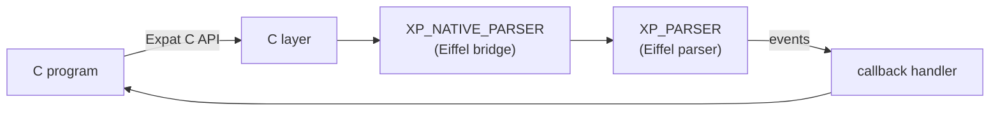

# Internship Report (short version): Building Confidence in an XML Parser

> **Student:** Masoud Dehdar · **Programme:** Software Developer .NET · **University:** Medieinstitutet
> **Company:** Bsharp · **Supervisor:** Anders Persson · **Internship:** 6 October – 27 November 2026 (eight weeks)
> **Repository:** [github.com/andersoxie/xpact](https://github.com/andersoxie/xpact), branch `incremental-test` @ `a840029` (2026-11-12, = `main` after PR #344) · **Full report:** [ActualReport.md](ActualReport.md)
>
> ✅ done and verified · 🟡 partly done · 🔴 open · ⏭️ dropped by decision · ✏️ for the student to complete

---

## Abstract
xpact is an XML parser written in Eiffel with a C interface compatible with **Expat**, the standard C XML parser. The internship asked: **how can we demonstrate that xpact handles valid and invalid XML consistently, with assertions enabled?** In the first four weeks of the eight-week internship at Bsharp, the work went from making the parser build on Windows, through an assertions-enabled baseline and reliable failure reporting, to large comparisons with Expat 2.8.1. The next week brought incremental parsing of chunked input, a full rerun of every test on the final parser, and a website for testing XML with xpact. Every problem was reproduced, explained, fixed in one focused pull request and verified before its issue was closed. Result: the whole W3C conformance suite (**2,585 cases**) runs with **0 failures**, xpact gives **the same verdict as Expat in every structured comparison**, and the worst chunked case went from **50 minutes to 106 ms**. Error positions and some events still differ from Expat. On the last day the two DLL blockers were fixed: an internal exception now returns an error code instead of crashing, and the DLL is safe from several threads (calls take turns). A SonarQube scan of the scripts and the website went from 196 issues to 0. Parallel parsing and the 10 MB input limit remain design questions for a 1.0 release.

## 🚦 At a glance

| | Result |
|---|---|
| ✅ Builds | Both native DLLs (assertions on and off) build and pass their smoke tests |
| ✅ W3C suite | 2,585 / 2,585 run: 2,283 checked + 302 "no crash only", **0 failed** (was: 1,360 crashes with assertions on) |
| ✅ Same verdict as Expat | 4,308 / 4,308 C-API cases · 1,302 / 1,302 chunked configurations · 525 / 525 SVG files |
| ✅ Final parser retested | Every test rerun on 2026-11-08: no regression, 3.9 million fuzzed inputs, 0 crashes |
| ✅ Failures are reported | A failing test exits nonzero in every build, proven by a meta-test |
| ✅ Traceable | 146 issues (129 closed) and 168 merged pull requests by the student (2026-11-12), plus 50 for the speed work; versions 0.1.0–0.9.0 |
| ✅ Code quality | SonarQube: **196 → 0 issues**, 0 bugs, 0 vulnerabilities, duplicated code 14 % → 0 %; 🟡 2 security hotspots to mark "Safe", gate needs a coverage report |
| ✅ Website | Upload XML and test it with xpact; all 7 review findings fixed, worker with no privileges at Low integrity; 42/42 backend tests; Docker image on GitHub; 🟡 not deployed yet |
| 🟡 Speed | Chunked input is incremental: 50 min → 106 ms. Against native Expat 2.8.1: median **18× slower**, same events in every cell ([results](../results/fair-speed-2026-11-10/README.md)). 🔴 ISO-8859-1 in pieces is still slow (#272) |
| 🟡 Details differ | Error positions and a few events and error codes (6 open findings) |
| 🟡 Blockers for 1.0 | ✅ exception → error code (#273); ✅ safe from several threads (#274). Open: parallel parsing (#304), documents over 10 MB |

---

## 1. Project and goal
An XML parser checks that a text follows the XML rules and reports what it contains as **events** (start tag, text, end tag), or an error if the document is broken. xpact offers Expat's C interface, but the parser is written in **Eiffel**, which supports **Design by Contract**: routines state conditions (*assertions*) that can be checked while the program runs. The company wants assertions on even in production, so the parser has to work correctly with them on.

**The guide's goals for the ten weeks:**
- [x] A setup guide another developer can follow
- [x] A recorded baseline (revision, settings, commands)
- [x] Tests for malformed input, callbacks and chunked input, with selected W3C cases
- [x] One reviewed improvement to the tests (all W3C cases, merged by the supervisor)
- [x] Week 8: shared fixtures and SVG / libxml2 cases
- [ ] A final report and demonstration 🟡 (this report; the demonstration is still to be held)

## 2. Tools and method
**Tools:**
- Eiffel, C, C#, Python and PowerShell
- EiffelStudio 25.12 and Visual Studio 18 (MSVC)
- Git and GitHub, GitHub Actions and Jenkins; SonarQube for code quality
- Expat 2.8.1 and the W3C XML Test Suite as references
- React, ASP.NET Core and Docker for the website; Boogie for two formal proofs

**AI:** Claude Code was used as an AI assistant throughout (code, tests, reports). The student set the goals and made the decisions. In the student's own estimate, this raised their efficiency about 100×.

**Method, for every problem:**
1. Reproduce it with the exact command.
2. Write the expected result first.
3. Save the logs.
4. Find the cause, marked confirmed, suspected or unknown.
5. Fix it in one pull request.
6. Verify it in both builds, against Expat.
7. Only then close the issue.

## 3. Work by week

| Plan week | Focus | Main result |
|---|---|---|
| 1 Setup | Build on Windows | ✅ the DLL builds; first bugs found |
| 2 Baseline | Assertions-enabled baseline | ✅ baseline; 53 W3C crashes had been scored as passes |
| 3 Failure reporting | Build fixes in git, B01/B02, CR repair | ✅ failing tests now fail; W3C crashes 1,360 → 47 |
| 4 Input matrix | Full check, 93 W3C cases (G01) | ✅ all tests pass with assertions on |
| 5 Regressions | Comparison with Expat | ✅ 4,308 / 4,308 same verdicts; 5 findings |
| 6 Improvement | All 2,585 W3C cases | ✅ 0 failed; merged by the supervisor, Jenkins passed |
| 7 Comparison | G03 (chunks), A04 (library check) | ✅ 1,302 / 1,302 same verdicts; findings fixed |
| 8 Consolidate (2–10 Nov) | Fixtures, new sources, speed, full rerun, website, Boogie | ✅ 247 fixtures; 50 min → 106 ms; no regression; `main` = `incremental-test` |
| 9–10 (11–27 Nov) | DLL blockers, website hardening, code quality, report, demonstration, handover | ✅ #273, #274 fixed; fair speed test; SonarQube 196 → 0; `main` synced again (12 Nov) · 🟡 this report, the demonstration |

## 4. Four investigations

**4.1 Assertions turned 1,360 W3C cases into crashes.**
- **Problem:** with assertions on, 1,360 of 1,727 cases crashed.
- **Investigation:** almost all of them broke the same contract, in `normalized_input`, and a 9-byte file with one CR reproduced it.
- **Cause (✔ confirmed):** a loop variant that didn't decrease when a CR was skipped. The code worked, but the contract was wrong, and with assertions off it was never checked.
- **Fix:** [#28](https://github.com/andersoxie/xpact/issues/28), and later [#80](https://github.com/andersoxie/xpact/pull/80).
- **Verification:** 1,360 → 47 → 0 crashes.
- **Lesson:** this is exactly why assertions belong in production builds.

**4.2 Failing tests reported success (B01, B02).**
- **Problem:** with assertions off, a failing test printed `FAIL:` but exited 0, so CI showed green.
- **Cause (✔ confirmed):** the tests used `check`, which assertions-off builds remove, and the runner didn't turn failures into an exit code.
- **Fix:** failures now give a nonzero exit code ([#45](https://github.com/andersoxie/xpact/issues/45)), and a switchable meta-test proves it ([#46](https://github.com/andersoxie/xpact/issues/46)).
- **Verification:** 12 runs, every result as predicted.

**4.3 No events before an error in a whole document (#172).**
- **Problem:** `<doc>abc\x11def</doc>` given whole produced no events; in pieces it produced `start doc` and `abc`, as Expat does.
- **Investigation:** a probe showed xpact split just before the bad character equals Expat in 7 of 7 documents. The event code was fine.
- **Cause (✔ confirmed):** a check of the *whole* input before parsing stopped at the bad character.
- **Fix:** parse the text in front of it first, then report the error ([#192](https://github.com/andersoxie/xpact/pull/192)).
- **Verification:** C# cases fully identical to Expat went from 1,079 to 3,423, and 0 got worse. The same fix also solved #122.

**4.4 Chunked input was re-parsed on every call (speed work).**
- **Problem:** a 131 KB document fed one byte at a time took **50 minutes**, because each call re-parsed everything from the start.
- **Fix:** about 20 small changes in a separate repository (CodTanium/mass-xpact): resume from a saved checkpoint, resume UTF-16 decoding, fewer copies and allocations.
- **Verification:** an acceptance run of 15 checks against the old base ([report](../../reports/acceptance-253c81e-vs-45d2f53/report.md)). Worst case **50 min → 106 ms**, whole documents 4–7× faster, nothing worse.
- **Lesson:** the acceptance run found two regressions the per-fix checks had missed (#68, #69); both were fixed before merging. It also found three open problems: no thread safety, slow ISO-8859-1 in pieces, and a DLL crash without a trace.

*The full report has four more: the Windows build, a test that ran against the wrong library (A04), the speed analysis, and Boogie models that find two old loop bugs.*

## 5. Testing

| Test | Shows | Result |
|---|---|---|
| Eiffel test matrix (4 lanes) | routines and contracts, assertions on/off | ✅ 4 / 4 |
| W3C suite | accept/reject against the standard | ✅ 2,585, 0 failed (rechecked 2026-11-10) |
| W3C output (432 cases) | the parsed content | 359 → **399** right |
| C# DLL tests vs Expat (4,308) | the C interface as a program sees it | ✅ same verdict in all; now also in Jenkins |
| G03 (93 cases × 14 ways of feeding) | the result doesn't depend on chunking | ✅ 1,302 / 1,302; 62 / 93 fully identical |
| New sources (week 8) | SVG 1.1, UTF-8, DTD attacks, libxml2 corpus | ✅ 525 / 525, 582 / 582, 104 / 104 verdicts |
| Fuzzing (30 + 20 min) | no crash on unexpected input | ✅ 3.9 million inputs, 0 crashes |
| Expat's own C tests | Expat's own expectations | 399 checks, 38 known failures |
| B02 meta-test, A04 library check | the tests themselves can be trusted | ✅ |
| Website: memory cap, load test | runaway documents stopped, parallel visitors | ✅ ~31–40 requests/s, 0 failures up to 32 at once |
| Python suite (test tools themselves) | the runners and report scripts | ✅ 239 / 239 |
| SonarQube (scripts and website) | code quality and security rules | ✅ 196 → 0 issues; 🟡 2 hotspots to review |

**Limits:** most runs were on one Windows machine; no Linux. Not tested or not working: documents over 10 MB, parallel parsing (several threads work since #274 but take turns), XML 1.1, and external entities fed in pieces.

## 6. Workflow
- `main` belongs to the company; the student never committed to it directly. It received the work only through reviewed merges (PR #177, and the syncs of 10 and 12 November, PR #344).
- Each change was its own `fix/…` branch, then a report with logs, then a pull request into the work branch: squash-merged into `student-Mass` until 8 November, then into `incremental-test`, with a merge commit (never squash) since 10 November.
- The supervisor reviewed and merged `student-Mass` into `main`, and Jenkins passed (PR #177). On 2026-11-10 `main` became the same commit as `incremental-test`.
- Small pull requests kept every change reviewable, easy to revert, and easy to trace from issue to commit. Since 2026-11-10 earlier states also have version numbers (0.1.0–0.9.0, [CHANGELOG](../../CHANGELOG.md)).

## 7. Open work

| Open | What |
|---|---|
| 🟡 #304, 10 MB limit | Parallel parsing (calls are serialized since #274); documents over 10 MB rejected: design decisions for 1.0 |
| 🔴 #272 | ISO-8859-1 in pieces is slow (16 B and 1 B pieces of 1 MB time out) |
| 🔴 #293 | Entities nested more than 32 levels deep: "syntax error" where Expat accepts (supervisor decision) |
| ✅ #273, #274 | Fixed 2026-11-11: exception → error code; safe from several threads |
| 🔴 [#123](https://github.com/andersoxie/xpact/issues/123), [#126](https://github.com/andersoxie/xpact/issues/126), [#170](https://github.com/andersoxie/xpact/issues/170), [#171](https://github.com/andersoxie/xpact/issues/171), [#176](https://github.com/andersoxie/xpact/issues/176) | Events, raw text, error codes, positions and `]]>` in pieces still differ from Expat |
| 🟡 [#211](https://github.com/andersoxie/xpact/issues/211) | Billion-laughs documents are stopped with Expat's error, but ~15× slower |
| ⏸ [#13](https://github.com/andersoxie/xpact/issues/13) | The GC wrapper swallows exceptions (a design question) |
| 🟡 [#210](https://github.com/andersoxie/xpact/issues/210) | Website deployment and HTTPS (the supervisor's server) |
| 🟡 [#342](https://github.com/andersoxie/xpact/issues/342) | SonarQube: 2 security hotspots to mark "Safe"; a coverage report for the quality gate |

## 8. Reflection ✏️
> *Draft. Rewrite it in your own words.*

The most useful habits were to **reproduce first** and to **keep the expected result separate from the actual one**. Several times the first explanation was wrong, and the evidence itself had to be checked: crashes scored as passes, tests that exited 0 on failure, a suite testing the wrong library, and per-fix checks that missed two regressions. Compared with university exercises, the hard parts were the size of an unfamiliar codebase, the build environment, and other people's work landing at the same time. Next time I would set up faster checks and a full acceptance run earlier, agree earlier on who reviews parser changes, and keep one work branch from the start.

## 9. Conclusion
In the first five weeks of the internship, xpact went from a parser that crashed on 1,360 W3C cases with assertions on, to one that runs the whole suite without a failure, gives Expat's verdict in every comparison, parses chunked input incrementally and can be tried on a website, with tests another developer can rerun. The main question can now be answered with evidence. What's left is detail (positions, events), one slow encoding, and design questions for the supervisor: parallel parsing, the 10 MB limit and the entity depth limit.

## References
[1] W3C, *XML 1.0 (Fifth Edition)*, 2008. https://www.w3.org/TR/xml/ · [2] W3C, *XML Conformance Test Suites* 20130923. https://www.w3.org/XML/Test/ · [3] libexpat 2.8.1. https://github.com/libexpat/libexpat · [4] B. Meyer, *Object-Oriented Software Construction*, 2nd ed., Prentice Hall, 1997. The full list is in [ActualReport.md](ActualReport.md#14-references).
