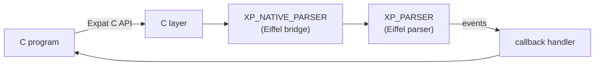

# Internship Report (short version): Building Confidence in an XML Parser

> **Student:** Masoud Dehdar ✏️ · **Programme:** System Developer ✏️ · **University:** [University name] ✏️
> **Company:** [Company name] ✏️ · **Supervisor:** Anders Persson ✏️ · **Internship:** 5 October – 1 November 2026
> **Repository:** [github.com/andersoxie/xpact](https://github.com/andersoxie/xpact), branch `student-Mass` · **Full report:** [ActualReport.md](ActualReport.md)
>
> ✅ done and verified · 🟡 partly done · 🔴 open · ⏭️ dropped by decision · ✏️ for the student to complete

---

## Abstract
xpact is an XML parser written in Eiffel with a C interface compatible with **Expat**, the standard C XML parser. The internship asked: **how can we demonstrate that xpact handles valid and invalid XML consistently, with assertions enabled?** In four weeks the work went from making the parser build on Windows, through an assertions-enabled baseline and reliable failure reporting, to large comparisons with Expat 2.8.1. Every problem was reproduced, explained, fixed in one focused pull request and verified before its issue was closed. Result: the whole W3C conformance suite (**2,585 cases**) runs with **0 failures**, and xpact gives **the same verdict as Expat in every comparison**. Error positions, some events and speed still differ from Expat.

## 🚦 At a glance

| | Result |
|---|---|
| ✅ Builds | Both native DLLs (assertions on and off) build and pass their smoke tests |
| ✅ W3C suite | 2,585 / 2,585 run: 2,283 checked + 302 "no crash only", **0 failed** (was: 1,360 crashes with assertions on) |
| ✅ Same verdict as Expat | 4,308 / 4,308 C-API cases · 1,302 / 1,302 chunked configurations |
| ✅ Failures are reported | A failing test exits nonzero in every build, proven by a meta-test |
| ✅ Traceable | 89 issues (80 closed), 82 merged pull requests, one report with logs per fix |
| 🟡 Details differ | Error positions and a few events and error codes (6 open findings) |
| 🔴 Speed | The DLL is 25–40× slower than Expat and re-parses its input on every call |

---

## 1. Project and goal
An XML parser checks that a text follows the XML rules and reports what it contains as **events** (start tag, text, end tag), or an error if the document is broken. xpact offers Expat's C interface, but the parser is written in **Eiffel**, which supports **Design by Contract**: routines state conditions (*assertions*) that can be checked while the program runs. The company wants assertions on even in production, so the parser has to work correctly with them on.

**The guide's goals for the ten weeks:**
- [x] A setup guide another developer can follow
- [x] A recorded baseline (revision, settings, commands)
- [x] Tests for malformed input, callbacks and chunked input, with selected W3C cases
- [x] One reviewed improvement to the tests (all W3C cases, merged by the supervisor)
- [ ] A final report and demonstration 🟡 (this report; the demonstration is still to be held)

## 2. Tools and method
**Tools:**
- Eiffel, C, C#, Python and PowerShell
- EiffelStudio 25.12 and Visual Studio 18 (MSVC)
- Git and GitHub, GitHub Actions and Jenkins
- Expat 2.8.1 and the W3C XML Test Suite as references

**AI:** Claude Code was used as an AI assistant throughout (code, tests, reports). The student set the goals and made the decisions. ✏️ *Adjust to your university's rules.*

**Method, for every problem:**
1. Reproduce it with the exact command.
2. Write the expected result first.
3. Save the logs.
4. Find the cause, marked confirmed, suspected or unknown.
5. Fix it in one pull request.
6. Verify it in both builds, against Expat.
7. Only then close the issue.

## 3. Work by week

| Plan week | Focus | Main result |
|---|---|---|
| 1 Setup | Build on Windows | ✅ the DLL builds; first bugs found |
| 2 Baseline | Assertions-enabled baseline | ✅ baseline; 53 W3C crashes had been scored as passes |
| 3 Failure reporting | Build fixes in git, B01/B02, CR repair | ✅ failing tests now fail; W3C crashes 1,360 → 47 |
| 4 Input matrix | Full check, 93 W3C cases (G01) | ✅ all tests pass with assertions on |
| 5 Regressions | Comparison with Expat | ✅ 4,308 / 4,308 same verdicts; 5 findings |
| 6 Improvement | All 2,585 W3C cases | ✅ 0 failed; merged by the supervisor, Jenkins passed |
| 7 Comparison | G03 (chunks), A04 (library check) | ✅ 1,302 / 1,302 same verdicts; findings fixed |
| 8–10 | Report and handover | 🟡 this report |

## 4. Three investigations

**4.1 Assertions turned 1,360 W3C cases into crashes.**
- **Problem:** with assertions on, 1,360 of 1,727 cases crashed.
- **Investigation:** almost all of them broke the same contract, in `normalized_input`, and a 9-byte file with one CR reproduced it.
- **Cause (✔ confirmed):** a loop variant that didn't decrease when a CR was skipped. The code worked, but the contract was wrong, and with assertions off it was never checked.
- **Fix:** [#28](https://github.com/andersoxie/xpact/issues/28), and later [#80](https://github.com/andersoxie/xpact/pull/80).
- **Verification:** 1,360 → 47 → 0 crashes.
- **Lesson:** this is exactly why assertions belong in production builds.

**4.2 Failing tests reported success (B01, B02).**
- **Problem:** with assertions off, a failing test printed `FAIL:` but exited 0, so CI showed green.
- **Cause (✔ confirmed):** the tests used `check`, which assertions-off builds remove, and the runner didn't turn failures into an exit code.
- **Fix:** failures now give a nonzero exit code ([#45](https://github.com/andersoxie/xpact/issues/45)), and a switchable meta-test proves it ([#46](https://github.com/andersoxie/xpact/issues/46)).
- **Verification:** 12 runs, every result as predicted.

**4.3 No events before an error in a whole document (#172).**
- **Problem:** `<doc>abc\x11def</doc>` given whole produced no events; in pieces it produced `start doc` and `abc`, as Expat does.
- **Investigation:** a probe showed xpact split just before the bad character equals Expat in 7 of 7 documents. The event code was fine.
- **Cause (✔ confirmed):** a check of the *whole* input before parsing stopped at the bad character.
- **Fix:** parse the text in front of it first, then report the error ([#192](https://github.com/andersoxie/xpact/pull/192)).
- **Verification:** C# cases fully identical to Expat went from 1,079 to 3,423, and 0 got worse. The same fix also solved #122.

*The full report has three more: the Windows build, a test that ran against the wrong library (A04), and the speed analysis.*

## 5. Testing

| Test | Shows | Result |
|---|---|---|
| Eiffel test matrix (4 lanes) | routines and contracts, assertions on/off | ✅ 4 / 4 |
| W3C suite | accept/reject against the standard | ✅ 2,585, 0 failed |
| W3C output (432 cases) | the parsed content | 359 → **399** right |
| C# DLL tests vs Expat (4,308) | the C interface as a program sees it | ✅ same verdict in all |
| G03 (93 cases × 14 ways of feeding) | the result doesn't depend on chunking | ✅ 1,302 / 1,302 |
| Expat's own C tests | Expat's own expectations | 399 checks, 38 known failures |
| B02 meta-test, A04 library check | the tests themselves can be trusted | ✅ |

**Limits:** most runs were on one Windows machine. Not yet tested: large real-world files, SVG or libxml2 cases, XML 1.1, and external entities fed in pieces.

## 6. Workflow
- `main` belongs to the company; the student never committed to it.
- Each change was its own `fix/…` branch, then a report with logs, then a pull request, squash-merged into `student-Mass`.
- The supervisor reviewed and merged `student-Mass` into `main`, and Jenkins passed (PR #177).
- Small pull requests kept every change reviewable, easy to revert, and easy to trace from issue to commit.

## 7. Open work

| Open | What |
|---|---|
| 🔴 [#123](https://github.com/andersoxie/xpact/issues/123), [#126](https://github.com/andersoxie/xpact/issues/126), [#170](https://github.com/andersoxie/xpact/issues/170), [#171](https://github.com/andersoxie/xpact/issues/171), [#176](https://github.com/andersoxie/xpact/issues/176) | Events, raw text, error codes, positions and `]]>` in pieces still differ from Expat |
| ⏸ [#13](https://github.com/andersoxie/xpact/issues/13) | The GC wrapper swallows exceptions (a design question) |
| 🔴 Speed | Re-parsing on every call; the supervisor's incremental parser is still a prototype |

## 8. Reflection ✏️
> *Draft. Rewrite it in your own words.*

The most useful habits were to **reproduce first** and to **keep the expected result separate from the actual one**. Several times the first explanation was wrong, and the evidence itself had to be checked: crashes scored as passes, tests that exited 0 on failure, a suite testing the wrong library. Compared with university exercises, the hard parts were the size of an unfamiliar codebase, the build environment, and other people's work landing at the same time. Next time I would set up faster checks earlier, and agree earlier on who reviews parser changes.

## 9. Conclusion
In four weeks, xpact went from a parser that crashed on 1,360 W3C cases with assertions on, to one that runs the whole suite without a failure and gives Expat's verdict in every comparison, with tests another developer can rerun. The main question can now be answered with evidence. What's left is detail (positions, events) and speed, which is an architecture question for the supervisor.

## References
[1] W3C, *XML 1.0 (Fifth Edition)*, 2008. https://www.w3.org/TR/xml/ · [2] W3C, *XML Conformance Test Suites* 20130923. https://www.w3.org/XML/Test/ · [3] libexpat 2.8.1. https://github.com/libexpat/libexpat · [4] B. Meyer, *Object-Oriented Software Construction*, 2nd ed., Prentice Hall, 1997. The full list is in [ActualReport.md](ActualReport.md#14-references).
